# GOLD RING

A browser-based, World Archery **style** target archery simulation built with Three.js and TypeScript.
Three divisions — Olympic recurve, compound and barebow — with real draw-force curves, a wind field you can
read on the flags, a third-person stance camera that blends into a first-person sight picture, and the
ranking round → elimination bracket → medal ceremony flow.

> **Unofficial.** GOLD RING is an educational fan project. It is not affiliated with, endorsed by, or
> connected to World Archery, the IOC, or any equipment manufacturer. All brand names in the equipment
> catalogue are fictional. No Olympic marks or logos are used.

## Screenshots

| | |
| --- | --- |
| 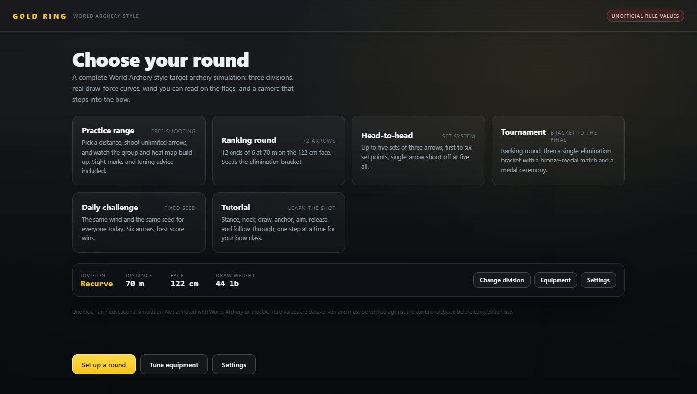 | 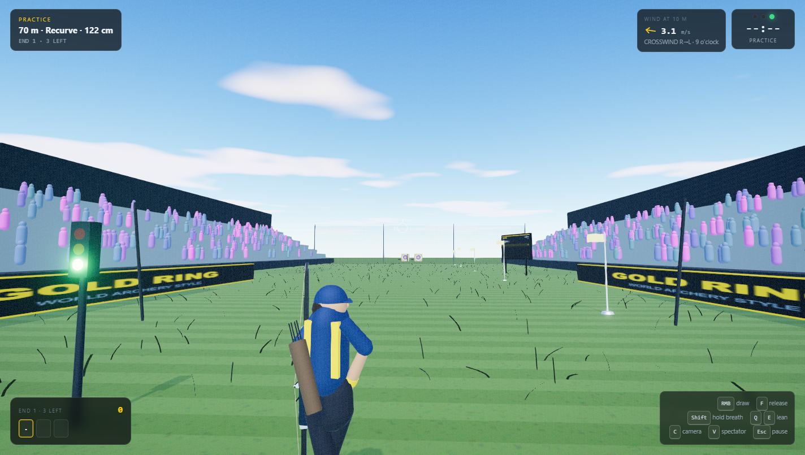 |
| 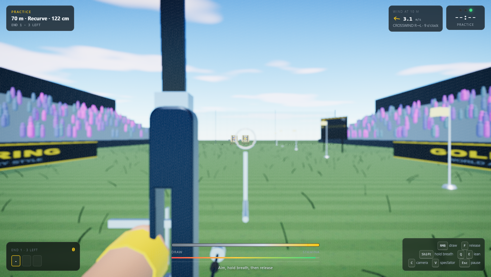 | 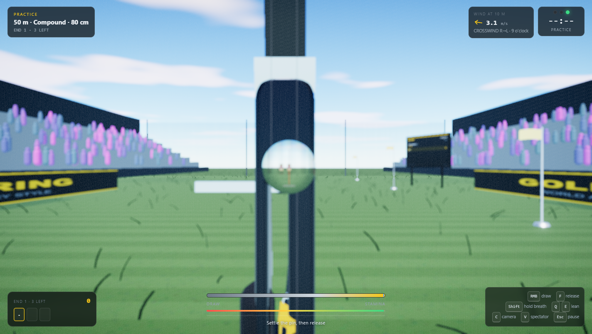 |
| 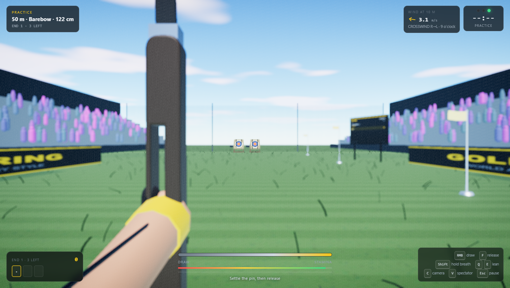 | 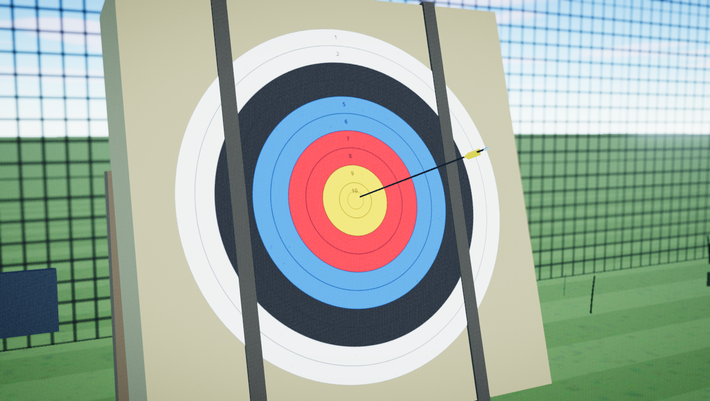 |
| 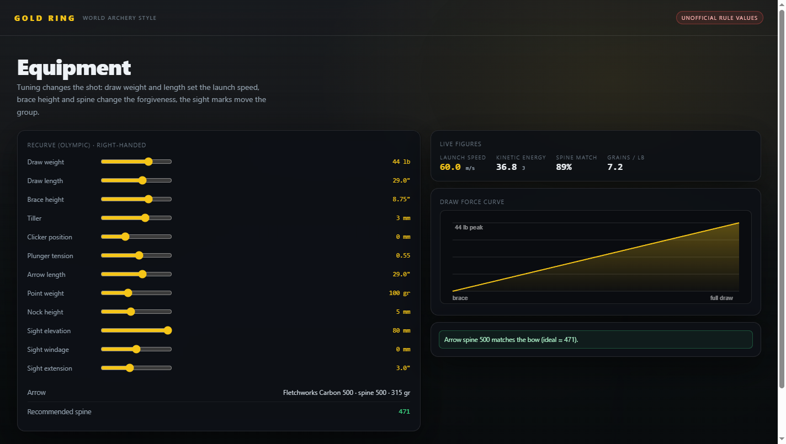 | 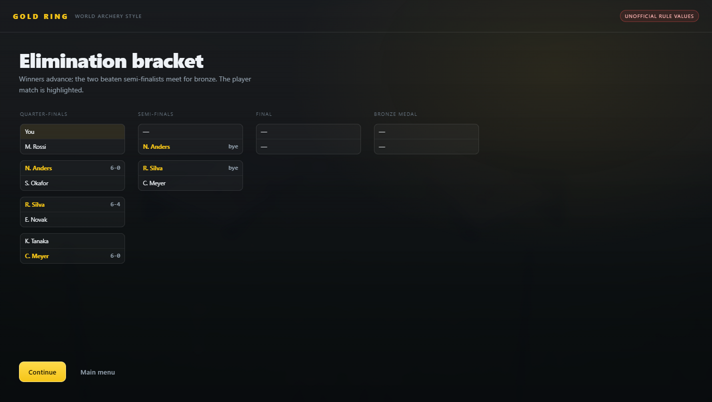 |
| 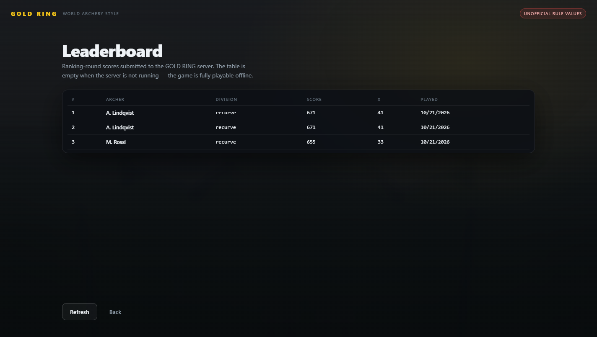 | 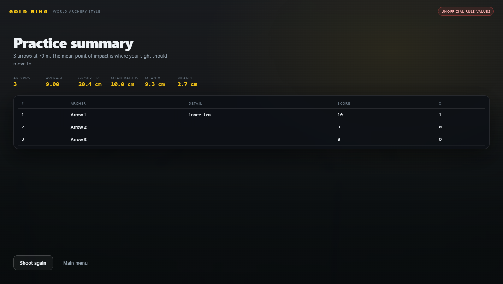 |
| 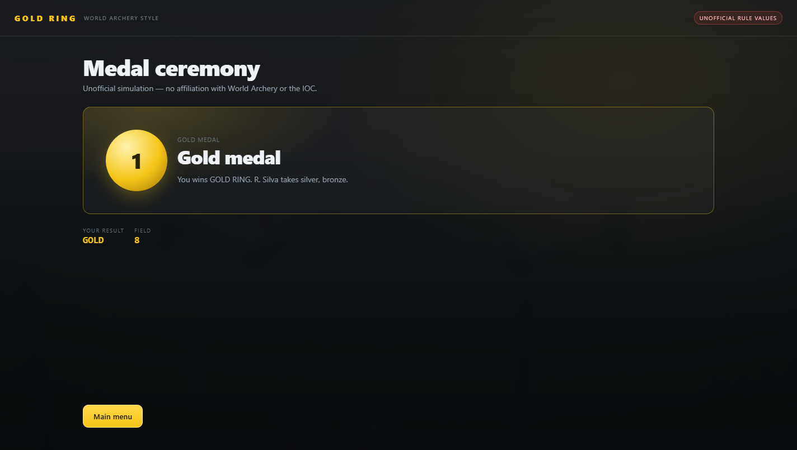 | 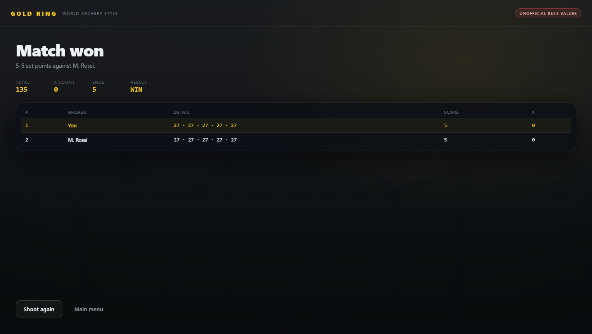 |
| 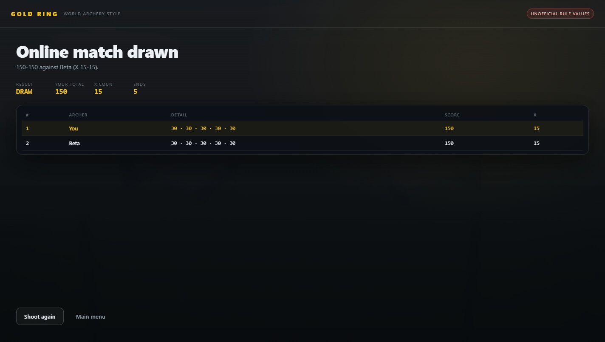 | |

Captured from the production build in Chrome (WebGL 2).

---

## Quick start

```bash
npm install
npm run dev          # client on http://127.0.0.1:5173
npm run dev:server   # optional API/WebSocket server on http://127.0.0.1:8080
```

The client runs fully offline. The server is only needed for leaderboards, daily seeds and multiplayer.

Production build:

```bash
npm run build        # static client in client/dist
npm run start        # Fastify server
```

## Controls

| Action | Binding |
| --- | --- |
| Draw the bow | Hold **right mouse button** (or right trigger) |
| Release | Let go of the draw button, or press **F** / **Space** |
| Aim | Move the mouse while drawing |
| Aim zoom | Mouse wheel (1x–6x; default 3.5x) |
| Aim assist | Settings → Camera → Off / Light / Strong |
| Hold breath | **Shift** |
| Cant the bow | **Q** / **E** |
| Sight / scope zoom | **Mouse wheel** |
| Cycle sight mark | **R** / **T** |
| Back to third person | **C** |
| Spectator cameras | **V** |
| Pause | **Esc** / **P** |
| Toggle HUD | **H** |

Touch: drag to draw and aim, release to shoot. Gamepad: right trigger draws, A / cross releases.

## The shot

1. **Stance** — side-on, feet straddling the shooting line.
2. **Nock** — the arrow appears on the string.
3. **Draw** — the draw meter fills. Recurve has a clicker at full draw; compound rolls over the cams into
   the wall and drops to its holding weight.
4. **Anchor and aim** — the camera blends into the eye position over 0.4 s. Recurve shows a pin sight,
   compound a scope with a level bubble, barebow a string picture and the arrow tip.
5. **Release** — release quality depends on draw length, hold time, stamina, clicker/wall and trigger punch.
6. **Follow-through** — 0.4 s in first person, then an optional arrow cam, then back to third person.

## What is implemented

- **Camera state machine** with `THIRD_PERSON → DRAWING_TRANSITION → FIRST_PERSON_AIM → RELEASE →
  ARROW_CAM / THIRD_PERSON` and spectator views. Transitions are unit tested.
- **Accessible aiming**: default 3.5x sight zoom (wheel up to 6x), plus Off/Light/Strong aim assist.
  Light steadies the sight and slows it near the gold; Strong also applies a partial automatic wind hold.
- **Three divisions** with distinct draw curves, let-off, holding weight, sight picture, speed and
  equipment limits (barebow has no sight, no stabiliser, no clicker).
- **Deterministic physics**: bow energy model, 240 Hz arrow integration with drag, wind, spin drift and
  a cosmetic arrow-paradox flex. The client and server run the *same* function.
- **Wind field** sampled by the arrows, the flags, the grass shader and the scoreboard.
- **World Archery style scoring**: ring values, line-cutter rule, X ring, judge review radius, timing
  penalties, set system, cumulative matches, single-arrow shoot-off, ranking seeding and a bracket.
- **Competition flow**: practice analytics (group size, mean point of impact), 72-arrow ranking round,
  head-to-head, tournament with bronze match, daily challenge, tutorial.
- **Online duel**: queue by division, five ends of three arrows, server-owned clock and authoritative
  shot scoring, live opponent totals and a result screen. The server, protocol and client session are
  covered by unit tests and a two-browser smoke test.
- **UI**: HUD with draw meter, clicker, stamina, pressure, clock, traffic light and end arrows;
  broadcast scoreboard; menus, equipment tuning with live stats, settings, results, bracket, medals and a
  server-backed leaderboard screen that degrades cleanly when the server is offline.
- **Audio**: procedural Web Audio soundscape (string, clicker, whoosh, impact, buzzer, crowd, wind) plus
  speech-synthesis judge calls. No audio downloads.
- **Server**: Fastify REST + `ws`, Zod validation, helmet, rate limiting, pino, JSON persistence, and
  server-authoritative shot replay. REST routes and matchmaking are covered by tests.

## Rules are data, and must be verified

Every number lives in [`shared/src/rules/worldArchery.json`](shared/src/rules/worldArchery.json):
distances, face geometry, ring colours, timing, signal phases, penalties and tie-breakers.

**`meta.rulebook.verified` is `false` on purpose.** The values have not been checked against an official
rulebook. Before using this for anything competitive:

1. Verify every value against the current World Archery **Book 3** (target archery) and the current
   competition-format book.
2. Update `meta.rulebook` with the edition, citation, verifier and date.
3. Set `verified: true`. The UI badge changes from "Unofficial rule values" to the rules edition, and
   `assertRulesVerified()` stops throwing.

The UI shows the unverified badge until then.

## Project layout

```
shared/            rules JSON + engine, scoring, timing, formats, bracket, physics, AI, gear, protocol
client/src/
  main.ts game.ts  boot and orchestration
  camera/          state machine, third person, first-person aim, arrow cam, spectator, rig
  render/          renderer (WebGPU/WebGL), lighting, post-processing, scope camera + shader
  archer/          procedural archer, stance, draw controller, breathing, animation helpers
  equipment/       recurve, compound, barebow, arrows, shared bow types
  range/           venue, target face, wind flags, grass, crowd, signals/scoreboard
  competition/     ranking round, match play, shoot-off, bracket, scoring analytics, match manager
  ai/              AI opponents (shared AI model + shared physics)
  ui/              HUD, menus, gear tuning, facade
  audio/ net/ state/ input/
server/src/        Fastify app, routes, ws match server, validation, JSON store
scripts/           probe and range-test
```

## Physics notes

- Launch speed comes from the integral of the draw-force curve over the power stroke, multiplied by
  efficiency: `KE = η · E_stored`, `v = √(2KE/m)`.
- Arrow flight is a fixed-step (240 Hz) integration of gravity and quadratic drag relative to the **moving
  air**, which makes wind drift fall out of the same term as speed loss.
- The impact point is the intersection with the **tilted** target face (15°), so the visual arrow and the
  score use one geometry.
- Human error enters as angles at the bow (release quality, spine mismatch, fatigue, cant, torque), never
  as a distance-scaled offset — a 3 mm grip error does not become 14 cm at 50 m.
- `npm run range-test` prints drop and drift at 30/50/70 m against the closed-form reference.

## Testing

```bash
npm test          # Vitest: rules, scoring, formats, timing, camera, physics, server validation
npm run typecheck # tsc for shared, client and server
npm run range-test
```

See [TESTING.md](TESTING.md) for the manual cross-browser and performance checklist.

## Deployment

Netlify and Vercel host the **static client only**; the Fastify + WebSocket server must run somewhere
that supports long-lived connections (Render, Fly.io, Railway, a VPS, or Docker).

- **Client**: `npm run build`, then publish `client/dist`. `netlify.toml`, `vercel.json` and
  `client/vercel.json` are included. On Vercel, import the **client** as a single project (root `client`,
  output `dist`); on Netlify, build from the repo root (publish `client/dist`).
- **Server**: `docker compose up --build`, or deploy `server/Dockerfile` (a `render.yaml` blueprint is
  included). Set `CORS_ORIGIN` to the client origin.
- **Connect them**: set `VITE_API_URL` (and optionally `VITE_WS_URL`) in Netlify/Vercel before building.
  `NetClient` derives `wss://…/ws` from the API URL.

Step-by-step instructions, environment variables and troubleshooting are in **[DEPLOY.md](DEPLOY.md)**.

Persistence is a JSON file under `DATA_DIR`. `server/src/db/schema.sql` documents the equivalent
Postgres schema when you outgrow it.

## Known limitations

- The WebGPU path is implemented and falls back automatically, but the post-processing chain and the
  compound scope render target are WebGL 2 only in this build.
- Online play is a single **five-end cumulative** format with no reconnect or ranked ladder yet. The server
  remains authoritative; if a player disconnects the other is returned to the queue screen.
- The archer, bows, venue and target faces are procedural (no GLB/KTX2 downloads), which keeps the game
  offline-safe but below a hand-modelled AAA asset set. `ASSETS.md` records this.
- Rapier is installed for future prop physics; arrow flight deliberately uses the shared deterministic
  integrator so client and server can replay the exact same shot.
- Judge voice uses the browser speech synthesiser, so its voice depends on the platform.

## Licence

MIT. See `LICENSE` if present; otherwise treat the source as MIT-licensed for this educational project.
